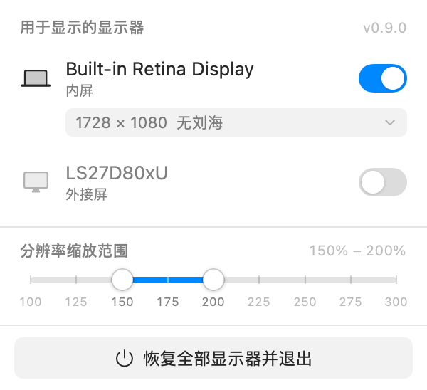
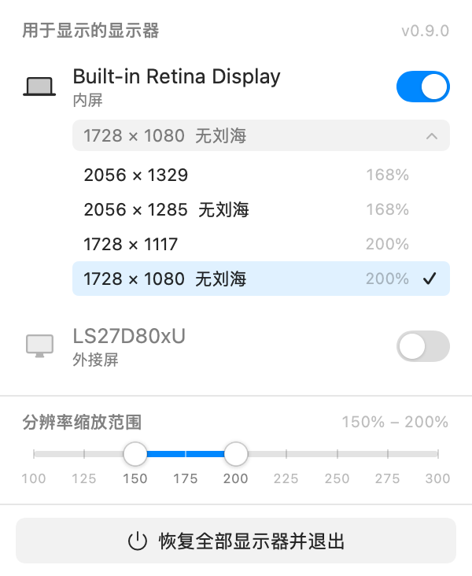

# MacOSDisplayToggle

外接显示器走 Type-C 一线通时，自由决定哪块屏幕参与显示、用多大的 Retina 分辨率。
关掉外接屏后系统只在内屏渲染，**充电和 USB 数据完全不受影响**。

两个适用场景：插着线只想充电、不想让桌上的大屏亮起来；以及想让某块屏显示更多内容。

<p align="center">
  
  &nbsp;&nbsp;
  
</p>

**环境要求**：Apple Silicon 的 Mac，macOS 13 及以上；只需要 Xcode Command Line Tools（`xcode-select --install`），不需要完整的 Xcode。

## 界面

顶栏常驻一个图标，点一下弹出面板：

```
┌──────────────────────────────────────┐
│ 用于显示的显示器              v0.9.0  │
│                                      │
│ 💻 Built-in Retina Display      [●]  │
│    内屏                               │
│    ┌ 1728 × 1117               ▾ ┐   │
│ 🖥 LS27D80xU                    [●]  │
│    外接屏                             │
│    ┌ 1920 × 1080               ▾ ┐   │
│ ──────────────────────────────────── │
│ 分辨率缩放范围              150% – 200% │
│ ●━━━━━━━━●────────────────────────── │
│ 100 125 150 175 200 225 250 275 300  │
│ ──────────────────────────────────── │
│        ⏻ 恢复全部显示器并退出          │
└──────────────────────────────────────┘
```

**开关**：控制这块屏是否参与显示。关掉的屏不会消失，而是留在列表里变灰，随时能再打开。

内屏也可以关掉——比如想只用外接屏。**任何操作都不会让你陷入全黑**：
当要关掉的屏是最后一块在用的屏时，工具会先把备用的屏点亮、确认它真的上线了，才去关目标屏。
顺序永远是「先开后关」，不存在中途两边都黑的瞬间。如果备用屏点不亮（比如线没插好），
这次关闭会直接放弃，保持现状不动。

如果系统出现极端异常导致真的一块屏都不剩，会立刻把刚关掉的屏开回来。

**拔线兜底**：「只用外屏、内屏已关」时直接拔掉一线通，画面就没地方显示了。
这不是工具的操作造成的，「先开后关」防不住，所以顶栏 App 每秒巡检一次，并监听显示器拓扑变化。
满足以下任一条件就判定为黑屏，连续两次确认（约 1–2 秒）后自动把内屏开回来：

- 在线显示器列表为空；
- 内屏是被我们关掉的，而列表里剩下的外接屏已经被系统通知「移除」（拔线后可能在列表里残留一阵）；
- 内屏是被我们关掉的，而 IOKit 显示外接视频链路已断开。

要求连续两次，是为了不被拔插、唤醒过程中的瞬时状态误触发。合盖导致的内屏离线不会触发（那是系统行为，不是我们关的）。
这个兜底依赖顶栏 App 在运行；只用命令行时没有守护。每次救援的每一步都会写进
`~/Library/Logs/MacOSDisplayToggle/events.log`，万一还是黑屏，把这个文件发出来就能看到卡在哪一步。

**分辨率**：只列 Retina（HiDPI）档位，点开在面板内展开，每档标注缩放百分比。带刘海的内屏会额外标出**无刘海**档——
这些档位宽高比大于面板，上下留黑边，刘海正好落在黑边里，内容区是完整矩形。

**缩放范围滑块**：拖动两端决定要放出哪些档位，范围 100%–300%，**25% 一档**（100 / 125 / 150 / 175 / 200 / 225 / 250 / 275 / 300），
每个停靠点在轨道下方标了数字，拖之前就知道能停在哪。默认 150%–200%。
默认区间是「字不会太小、也不会浪费空间」的实用区间；想放出更多档位（比如 4K 屏的 3360×1890 或放大档 1280×720）
把滑块拖宽即可，松手后列表立即更新，选择会记住。

步进定成 25% 而不是更细，是因为实际档位本来就稀疏（4K 屏是 114/120/128/150/167/188/200/229/240/255/300），
再用 1% 精度拖动没有意义；而 25% 恰好能让 125% 卡住 128%、225% 卡住 229%，粒度够用且好拖。

无论范围怎么设，当前正在用的那一档始终保留在列表里，不会因为收窄范围而看不见自己。

分辨率切换等同于在系统设置里改，**重启后保持**；开关状态则是临时的，工具退出或重启就恢复。

图标跟随状态变化：双屏是两个方块，仅内屏是笔记本。

## 命令行

```bash
macosdisplaytoggle status    # 列出显示器与开关状态
macosdisplaytoggle only      # 关闭全部外接屏
macosdisplaytoggle all       # 恢复所有显示器
macosdisplaytoggle toggle    # 两者切换
macosdisplaytoggle version   # 显示版本号
```

分辨率只做界面入口（命令行切分辨率用系统设置更快）。

## 安装

```bash
git clone https://github.com/jingyuancao/MacOSDisplayToggle.git
cd MacOSDisplayToggle
./build.sh --install     # 构建 + 装到 /Applications + 建 /usr/local/bin/macosdisplaytoggle，并重启到新版
```

只构建不安装：`./build.sh && open build/MacOSDisplayToggle.app`

开机自启：系统设置 → 通用 → 登录项 → 添加 MacOSDisplayToggle。

本地构建用的是 ad-hoc 签名，不经过公证。自己从源码构建运行不受影响；如果把构建好的 `.app` 拷给别人，
对方首次打开需要右键 →「打开」。

## 源码结构

| 文件 | 职责 |
| --- | --- |
| `Sources/DisplayAPI.swift` | 系统接口层。SkyLight 私有调用、显示器枚举、显示模式枚举与切换。无状态，可单独验证。 |
| `Sources/DisplayStore.swift` | 状态与业务规则。下线记录持久化、开关、恢复、分辨率切换、安全阀。 |
| `Sources/Panel.swift` | 视图层。面板布局、双端滑块、分辨率下拉、自绘开关。 |
| `Sources/main.swift` | 入口。CLI 子命令与顶栏 App 共用同一个二进制；顶栏 App 负责黑屏巡检。 |
| `Sources/EventLog.swift` | 本地事件日志，记录开关、恢复、拓扑变化与黑屏救援的每一步。 |
| `Sources/Version.swift` | 版本号唯一来源，build.sh 从这里读取写入 Info.plist。 |

`./build.sh` 直接用 `swiftc` 把 `Sources/` 下的文件编译成 app bundle，不需要 Xcode 工程，也没有第三方依赖。

## 原理

### 让显示器下线

macOS 没有公开 API 能「停用某个显示器」。公开的 `CGDisplayCapture` 需要 root 权限，而且它只是黑屏，显示器仍占着桌面空间、光标仍会飘过去。

真正能让显示器从系统消失的是 `SkyLight.framework` 里的私有接口：

```c
CGError CGSConfigureDisplayEnabled(CGSConfigDataRef cfg, CGDirectDisplayID display, bool enabled);
```

**第一个参数不是连接 ID，而是显示配置对象** —— 这点最容易踩坑：按 `(connectionID, display, bool)` 传，系统会把 connection ID 当指针解引用，进程直接段错误（崩溃栈停在 `checkCapacity(CGSConfigData*)`，地址恰好就是传入的 cid）。正确用法是借用公开 API 的事务对象把私有调用包起来：

```c
CGBeginDisplayConfiguration(&cfg);                            // 公开
CGSConfigureDisplayEnabled(cfg, display, 0);                  // 私有
CGCompleteDisplayConfiguration(cfg, kCGConfigureForSession);   // 公开
```

效果等价于在系统设置里把这个显示器「拔掉」：桌面空间回收、窗口自动迁回内屏、光标不会再跑到外接屏。DisplayPort 的 PD 供电是独立链路，因此充电和 USB 数据都不受影响。

三个实现上的坑，都已在代码里处理：

1. **提交结果不可信**。系统在「本次配置无实际变化」或重复提交时常返回 `CGError 1001`，但状态其实已经生效。所以以**复查在线显示器列表**为唯一判据，不看返回码。
2. **显示器掉出系统后需要显式 enable 才回来**。`CGSDetectDisplays`（等价于系统设置里的「检测显示器」）也不一定能把它拉回来，必须用原 display id 调 enable。因此关掉时会把 id、名字和「是不是内屏」写进 `~/Library/Application Support/MacOSDisplayToggle/state.json`。
3. **状态记录可能丢**。恢复时逐级升级手段：按记录的 id enable → 强制重新检测 → 扫描 display id 逐个启用，最多三轮。
   扫描之前**必须先 redetect**：显示器掉进「链路在、但系统没枚举」的状态时，直接 enable 会返回成功却毫无作用（实测踩过这个坑）。

### 关闭的时序

关闭一块屏本身是允许的，**主显示器也能关**（关闭后系统会自动把 main 转移给剩下的屏，实测返回 CGError 0）。
真正的难点在顺序：

- 如果关完就没屏了，先把备用屏点亮并复查它确实在线，再关目标屏——绝不能先关后开。
- 刚点亮备用屏就立刻关主屏，系统可能还没提交完拓扑变更而**拒绝**这次关闭（返回成功但屏幕没消失）。
  所以关闭操作本身带重试，间隔几百毫秒；备用屏已经亮着，重试期间不存在黑屏风险。
- 关闭后如果发现一块屏都不剩，立即回滚。

### 刘海屏的识别

判断「这块屏带刘海」有两种依据，代码里取或：

- `NSScreen.safeAreaInsets.top > 0`。但它在显示器刚被重新启用时会滞后，那一瞬间会误报「没刘海」。
- **模式列表的成对比例**（更可靠）：刘海屏会为同一逻辑宽度同时提供「铺满」和「上下留黑边」两套宽高比，
  例如内屏的 1728×1117(1.547) 与 1728×1080(1.600)；非刘海屏只有单一比例。

因此 NSScreen 查询结果只缓存 `true`（刘海是这块屏的固有属性），`false` 每次都重新判断，避免把瞬时错误固化下来。

### Retina 档位从哪来

`CGDisplayCopyAllDisplayModes` 默认只返回硬件原生模式，必须传 `kCGDisplayShowDuplicateLowResolutionModes: true` 才能拿到 HiDPI 档——不传这个键，HiDPI 模式数是 0。

「是否 HiDPI」的判据是 `pixelWidth == width * 2 && pixelHeight == height * 2`，即像素是逻辑点的两倍。

**面板真实尺寸**取自 ioFlags 里的 `kDisplayModeNativeFlag (0x02000000)`。
这里有个陷阱：如果直接对所有模式取像素最大值当面板尺寸，会把「超采样」档（4K 屏上的 6720×3780）误当成面板，过滤就失效。

**筛选维度是缩放比例**，即 `面板像素宽 / 逻辑宽`，取滑块给出的区间（默认 150%–200%）。
不能用「渲染像素是否超过面板」来判断档位大小——4K 屏的 2560×1440 需要 5120×2880 缓冲，像素确实超过面板，
但它恰恰是 150% 缩放，属于必须保留的档位。这两者容易混，第一版就栽在这里。

**默认区间为什么是 150%–200%**：200% 是 Retina 标准（逻辑 = 像素/2）；150% 的下限按实际像素密度定的——
27" 4K 上 150% 约 109 ppi，与 iMac 27" 5K 的逻辑密度一致，而 128% 就到 128 ppi，
比 MacBook 内屏（127.5 ppi）还密，桌面观看距离下明显偏小。

默认值不做 ppi 自适应，是因为不同屏的观看距离不同（笔记本 40-50cm、桌面屏 60-70cm），
用统一 ppi 阈值会把 Apple 官方给 16" MacBook 的「更多空间」档（2056×1329，152 ppi）也误杀。
所以下限交给滑块，由人自己判断。

一个边界：范围收窄后如果当前档位落在区间外，仍会被强制加进列表末尾，否则用户看不到自己现在在哪一档。

**无刘海怎么判定**：内屏宽高比是 3456/2234 ≈ 1.547，刘海占据顶部。系统为刘海屏同时提供两套档位——
1.547 的（如 1728×1117，铺满屏幕、含刘海）和 1.60 的（如 1728×1080，上下留黑边）。后者宽高比大于面板，
高度方向放不下，内容居中，刘海正好坐进顶部黑边里。所以判据就是 `模式宽高比 > 面板宽高比`。
系统是否真有刘海，用 `NSScreen.safeAreaInsets.top > 0` 判断。

不去改 `/Library/Displays/.../Overrides` 那套覆盖文件，也不需要虚拟屏扩展。

## 出问题了怎么办

**显示器没回来**：

1. 再打开面板，把开关打开
2. 终端执行 `macosdisplaytoggle all`
3. 拔掉 Type-C 线重新插上（系统会重新枚举显示器）
4. 系统设置 → 显示器 → 按住 Option 点「检测显示器」
5. 还不行就重启，显示器配置不会残留

**分辨率不合适**：系统设置 → 显示器，或本工具面板里重选。分辨率改动是持久的，工具退出不会回滚。

工具不会让显示器永久失效——开关状态只存在于当前登录会话的 WindowServer 里。

## 已知限制

- 显示器开关依赖私有 API。macOS 大版本升级后若失效，表现是「开关点了没反应 / 报 CGError」，不会损坏硬件。
- 外接屏被关掉后，显示器本身会进入无信号待机。少数显示器在无信号时会一直亮着「无信号」提示框，这属于显示器固件行为。
- 分辨率档位按缩放区间筛选（滑块可调，默认 150%–200%）。100% 附近通常没有档位可放，
  因为系统不提供需要 2 倍缓冲的 HiDPI 模式，实际最小档就是面板的 ~114%。
- 关闭内屏后菜单栏会跟到外接屏上，面板仍然可用。
- 从「仅内屏」切到「仅外屏」时，会先点亮外接屏再关内屏，物理屏幕上能看到双屏闪一下，属正常过程。

## 版本说明

当前版本在面板右上角、命令行 `macosdisplaytoggle version`（或 `status` 第一行）、顶栏图标的悬停提示里都能看到。
完整版本形如 `v0.9.0 (build 202610231716)`，build 号是构建时间，用于区分同一版本的多次构建。

发版约定：改 `Sources/Version.swift` 里的 `number`，在下表追加一行，再执行 `./build.sh --install`。

| 版本 | 变更 |
| --- | --- |
| **v0.9.0** | 项目更名：OnlyInternal → **MacOSDisplayToggle**（App、命令行 `macosdisplaytoggle`、Bundle ID `io.github.jingyuancao.MacOSDisplayToggle`、仓库名一并更改）。首次运行会自动沿用旧版的下线记录和缩放范围设置；日志目录改为 `~/Library/Logs/MacOSDisplayToggle/`。功能无变化。 |
| v0.8.1 | 开源发布：MIT 许可证；Bundle ID 改为 `io.github.jingyuancao.OnlyInternal`（缩放范围设置会回到默认 150%–200%）；截图移到 `docs/`；README 补充环境要求与 clone 安装方式。功能无变化。 |
| v0.8.0 | 修复「只用外屏时拔线一直黑屏」：守护原来只认「在线列表为空」，拔线后外接屏可能残留在列表里，守护一直不触发。现在同时识别「被系统移除的残留」和「视频链路已断开」；巡检从 2 秒缩短到 1 秒；禁用 App Nap，防止黑屏时定时器被节流。新增版本号显示、`version` 命令、本地事件日志 `~/Library/Logs/OnlyInternal/events.log`。`--install` 会自动退出旧版并启动新版。 |
| v0.7.0 | 允许关闭内屏、只用外屏。关闭时「先开后关」：关完会没屏时，先点亮备用屏并确认上线，再关目标屏。新增拔线守护（初版）。修复关闭的内屏被显示成外接屏、外接屏被误判为刘海屏、分辨率选项 id 冲突、命令行与顶栏 App 状态不同步。 |
| v0.6.0 | 代码按「系统接口 / 状态与业务 / 视图 / 入口」四层重构。修复启动时可能误清空下线记录、显示器掉进「链路在但未枚举」时恢复不了。 |
| v0.5.0 | 底部缩放范围滑块：100%–300%，25% 一档，刻度下标数字，默认 150%–200%，选择会记住。 |
| v0.4.0 | 分辨率按缩放比例筛选，补回 4K 屏的 2560×1440（150%）；每档显示缩放百分比。 |
| v0.3.0 | 已开启的显示器可切换 Retina 分辨率；内屏额外列出无刘海档位。 |
| v0.2.0 | 顶栏弹出面板：显示器列表（名称、内屏 / 外接屏、开关）、「恢复全部显示器并退出」按钮。 |
| v0.1.0 | 首版：一键关闭外接屏只留内屏，充电不受影响；顶栏图标 + 命令行。 |

## 已验证环境

- macOS 27.0.1（Build 26A434），Apple M4 Pro
- 内屏 3456×2234（带刘海），外接三星 LS27D80xU 4K，Type-C 一线通
- 编译与运行均无需 root、无需辅助功能权限、无需屏幕录制权限

## 许可证

[MIT](LICENSE)。本工具调用了 macOS 私有接口（SkyLight），系统升级后可能失效；使用风险自负。
